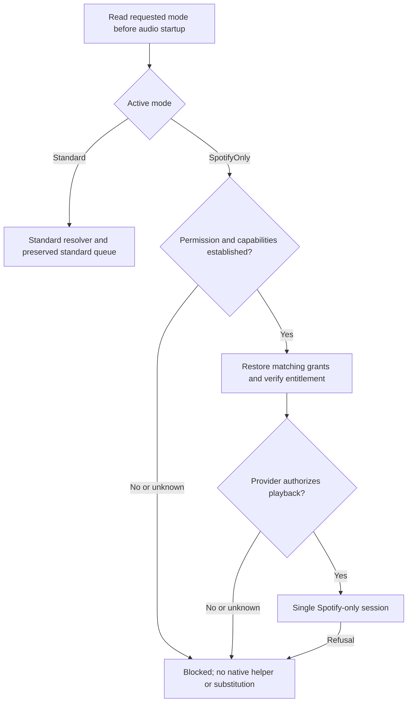

# Spotify-only playback: conditional technical design

23 October 2026. **Design only; no new playback mode or handoff action is implemented.** Spotify-only playback is technically feasible. Its activation is held for application permission, approved access and verification, not a technical impossibility. This document does not establish compliance for any proposed product.

The existing native PCM helper, authentication, queue behavior, provider-refusal fixes and all other tested workstreams remain unchanged. The unavailable Spotify source-priority row remains unavailable. A separate exclusive engine would not make Spotify priority #2 in the standard resolver. See the [existing assessment](spotify-exclusive-feasibility.md) for the inspected Spotifast architecture and helper protocol.

## 1. Product choices and recommendation

| Choice | Technical boundary | Work and tradeoffs | Permission status |
| --- | --- | --- | --- |
| Restart-separated mode inside BitChord | One immutable playback mode per process; no other-service playback or background content jobs in Spotify-only mode. Settings remain stored independently. | Reuses the current UI, queue and helper. Must guard every entry point and disable incompatible content surfaces. A restart provides a clear lifetime boundary but does not make the entire product a different application. | Unresolved: Spotify would need to accept the actual multi-service product and the proposed isolation/access model. |
| Standalone Spotify-focused application | Separate executable, application identity, credential storage and queue; no other-service resolver, mixed queues or background service integrations in its runtime dependency graph. | Stronger separation and a smaller test surface, but requires extracting neutral queue/UI/session components, a separate installer and maintenance. Sharing audio through IPC or automatically transferring mixed queues would defeat the intended boundary. | Unresolved: separation does not authorize an unofficial client, borrowed client identity or a replacement Spotify experience. |
| Explicit handoff to the official Spotify client | No Spotify PCM, decoder, analysis or playback-control API in BitChord for this action. BitChord opens a validated Spotify resource externally. | Smallest audio integration surface; playback controls, authorization and output remain with Spotify. OS launch success cannot confirm playback. | No native-playback permission is inferred. Any Spotify metadata/API use and the surrounding application still require their own applicable review. |

Recommendation: evaluate the explicit external handoff first if a fallback is wanted. For future native playback, present both product shapes and the exact access mechanism to Spotify. A genuinely standalone application provides stronger engineering isolation; it is not an enforcement workaround or a compliance conclusion. Do not decide that packaging alone resolves the permission question.

## 2. Permission requirements and unresolved questions

The published [Developer Policy](https://developer.spotify.com/policy) restricts integration with other services, mixing/overlap, content analysis and replication of Spotify's core experience, and requires Premium for music streaming. The [Developer Terms](https://developer.spotify.com/terms) separately govern access mechanisms, client identities, data and security. These constraints remain relevant to both product choices. The following are proposed engineering release gates, not a claim that every row is a separately obtainable Spotify approval or that approval has been granted.

| Gate | Evidence required before activation | Current state / question to resolve |
| --- | --- | --- |
| P1: Product/use case | Applicable documented authorization covering the actual product, distribution and features, with scope and review date. | None established. Does Spotify accept restart isolation inside BitChord, or require a genuinely separate product? What independent value is acceptable? |
| P2: Playback mechanism | Authorization for the proposed native PCM/librespot access, or selection of an approved supported mechanism and its restrictions. | The existing helper is technically functional and unofficial. Its existence and Spotifast's existence are not authorization. Is this mechanism permitted at all for this product? |
| P3: Application identity | Provider-confirmed use of the required client identities, scopes and redirect configuration. | The current library and playback grants are separate; playback uses the desktop identity referenced by librespot/Spotifast. Can this identity and two-grant arrangement be used by this application? Do not rotate or impersonate clients to recover access. |
| P4: Account and entitlement | Fresh, matching authorized account identities plus a documented provider-supported entitlement check. | A saved token or unknown `product` is insufficient. Which positive account/entitlement evidence is available for the approved mechanism? Premium-required refusal must remain binding. |
| P5: Permitted features | A reviewed capability list covering playback, metadata, lyrics/Canvas, media sessions, audio processing and diagnostics. | Analysis, AutoMix, crossfade, content-based metrics and synchronized visuals must not enter the proposed Spotify path without applicable permission. Do not assume ordinary DSP or local-only processing is exempt. |
| P6: Data and distribution | Reviewed retention/disconnect behavior, protected credentials, required attribution/notices and distribution/commercial conditions. | Mode switching is not consent withdrawal. Define what must be removed on explicit disconnect/revocation, while preserving unrelated services' settings. |
| P7: Refusal/recovery | Documented meanings, scope and permitted recovery for the responses actually exposed by the approved interface. | No universal `UserViolation` or mixed-service reason exists in the inspected helper mapping. What structured reason and clearance evidence can the provider supply? |

Record authorization references and restrictions in a reviewed release profile outside public source when confidential. Its public capability summary must not contain credentials or imply endorsement. This record is a development/release gate, not a new license protocol, DRM replacement or a user-selectable “I have permission” checkbox. Runtime provider authorization and refusals remain authoritative. An unknown or withdrawn permission gate produces a blocked state and no new native session.

The official [Web Playback SDK](https://developer.spotify.com/documentation/web-playback-sdk) is a browser playback mechanism. It is an alternative to evaluate, not a supported native PCM adapter or an automatic permission exemption. Choosing it changes the decoder/control design and requires separate verification.

## 3. Existing implementation boundaries inspected

All paths below are relative to the authoritative source root. These are existing code facts, not implemented new-mode behavior.

- `desktopApp/src/main/kotlin/com/music/bitchord/desktop/DesktopSpotifyPlayback.kt`: `restore`, `connect`, `accessToken` and `disconnect` preserve a separate playback grant and verify account consistency around native authentication.
- `DesktopSpotifySession.kt` and `DesktopSpotifyOAuth.kt` in that directory: protected grant storage, revision ownership, refresh serialization and PKCE/callback lifetime remain reusable.
- `DesktopSpotifyRuntime.kt`: `authenticate` starts an authentication-only helper; `source` validates an exact native Spotify track ID and supplies the existing PCM source. `DesktopSpotifySource.kt` owns read/seek/retirement.
- `DesktopSpotifyStreams.kt`: `asNativeSong` and `resolve` retain native track identity. `DesktopSpotifyLibrary.kt::loadSpotifyPlaylist` selects native rows when connected; otherwise it can invoke `SpotifyImporter.matchTrack`. The proposed exclusive mode must never enter that matching branch.
- `DesktopApp.kt`: `playSong`, `playSongs`, `enqueue`, restore and media/party actions feed the queue/engine. `canonicalSong` fills metadata without changing the ID; it is not itself a cross-provider matcher. Guard both catalog conversion and these queue entry points.
- `DesktopAudioEngine.kt`: the class is `DesktopPlaybackEngine`. Native opening uses the helper; native retry failure stops rather than substituting, midstream refusal retains its message, and existing native analysis/AutoMix exclusions remain.
- `DesktopSourceRegistry.kt` excludes `DesktopSourceKind.SPOTIFY` from adapters; `DesktopSourceConfig.kt` describes its ordered-playback unavailability.
- `desktopApp/native/spotify/src/main.rs::authentication_code` maps the pinned public “Application banned” authentication reason to protocol code 313. This is not a provider statement about a multi-source cause.

## 4. Proposed contracts and state ownership

Names in this section are proposed implementation contracts. They do not exist merely because they are documented here.

| Contract | Responsibility |
| --- | --- |
| `DesktopPlaybackModeStore` | Persist a schema-versioned requested mode (`Standard` or `SpotifyOnly`) independently of source configs and credentials. Atomic save; invalid/unknown values enter a safe standard/blocked migration path with an explanatory notice. |
| `DesktopPlaybackBootstrap` | Capture one immutable active mode before restoring streaming grants, queues or starting engines/jobs. Consume the reviewed permission/capability profile. Construct only the allowed runtime. |
| `SpotifyPlaybackEligibility` | Distinguish permission unknown/denied, helper missing, sign-in required, account mismatch, entitlement unknown/denied, provider restriction and ready. Authentication success is not application permission. |
| `SpotifyQueuePolicy` | Accept only verified Spotify catalog identities before queue mutation and again before engine load/seek/next. Reject rather than rewrite, match or silently remove incompatible entries. |
| `SpotifyOnlyPlaybackSession` | Own a single current helper/audio source and monotonically increasing operation generation. Reuse existing source/session components; permit only approved operations. Never reference the standard resolver or downloader. |
| `SpotifyRefusalEvidence` | Keep bounded origin/code/reason/scope provenance and generation without tokens or raw provider logs. Separate observed refusal from inferred cause. |
| `SpotifyExternalHandoff` | Validate a canonical resource, coordinate local pause/release and request an OS launch. Return launch outcome, not a fabricated playback state. |

The proposed session exposes load, play, pause, seek, skip and stop with existing queue/position semantics. If reusing `DesktopPlaybackEngine`, introduce a mode/capability boundary before any resolver, analyzer, upcoming preparation or sink side effect. A UI-only check is insufficient. If that boundary cannot prevent standard services from being instantiated/called, extract the native session path instead; retain the standard engine's tested behavior. For a standalone app, exclude standard services from the runtime graph rather than hiding their controls.

### Startup and restart

Changing the requested mode saves only a pending choice. Show the currently active engine and “Restart to apply”; current audio continues under the active mode until the user closes/restarts normally. Do not start a second engine when the pending choice changes. On restart, the old process must finish and release its sink/helper before a new audio owner starts. If retirement is unconfirmed, remain blocked rather than start overlapping playback.

The future standard profile must not restore/authenticate native Spotify playback or launch its helper. The future Spotify-only profile must not instantiate standard resolution, health probing, speculative stream fetching, AutoPlay/radio or party playback. Guard out-of-band hooks too: `DesktopApp.kt::playCurrent` currently calls `DesktopScrobbling.updateNowPlaying`; third-party scrobbling, shared listening, downloads and other content transfers must not run for this profile without the applicable permission. Whether other-service metadata may remain visible is part of P1; the conservative proposed profile shows only authorized Spotify content and ordinary local settings. Stored standard preferences remain dormant, not rewritten to disabled.

### Single-session lifecycle

1. At approved startup, load protected grants through the existing session revision rules. Establish positive entitlement through the agreed interface; unknown remains blocked. Never promote a token, helper availability or a profile display name into authorization evidence.
2. Validate an exact Spotify ID. Preserve the provider identity and any provider-supplied relinking provenance; never match by title/artist into another service. Unavailable tracks remain unavailable.
3. Increment the operation generation before load/seek/skip/disconnect. Cancel obsolete resolution/read jobs, retire the current source and obtain helper/sink release acknowledgement before opening its replacement. Position and media-session publication belong to the same generation.
4. No next-track PCM prefetch/helper, crossfade, two-deck overlap or speculative authentication-only helper while audio is running. Audit both seek restart and authentication refresh so they cannot open a second session. Token refresh may use the existing serialized grant path when the approved interface permits it; revocation interrupts playback.
5. Disable Spotify audio analysis, AutoMix, downloads, rendition fallback, waveform/beat extraction, content-based instrumentation and unapproved DSP/visual synchronization at the capability boundary. Standard-mode settings/features remain intact. Ordinary PCM conversion/output operations also need review under P5; the helper's preservation is not a claim that every existing processing option is approved.
6. On EOF, close the current helper/output before advancing within the validated Spotify queue. On refusal, stop and keep the selection/position; do not turn refusal into EOF, queue advance, retry against another identity or non-Spotify fallback.

Preserve the existing per-track helper design unless tests show a need to change it. Spotifast's long-lived session is a reference, not a reason to replace working authentication, queue or protocol code. Source files can be retained while a future product profile limits which code can execute; no removal is proposed in this documentation update.

## 5. Persistence, migration and rollback

- Proposed mode schema: version 1, requested mode; active mode is derived at process startup and never persisted as proof of readiness. The approval/profile version and provider-refusal evidence are separate from the mode preference.
- Retain all current source configurations, credentials, custom/built-in order, enabled states, JioSaavn consent, visual settings and AutoMix preferences. Never rewrite standard settings merely because the Spotify profile cannot use them.
- Preserve the legacy queue unchanged. Introduce separate versioned standard and Spotify queue snapshots only when the mode implementation is approved. Copy compatible entries on explicit migration; do not destructively partition or reinterpret an existing mixed queue. An incompatible snapshot remains recoverable and cannot autoplay. Preserve order, index and original Spotify references.
- Existing users currently have a native Spotify path in the unified application, not these two implemented modes. A future migration must explain that distinction, obtain an explicit mode choice and avoid silently changing legacy native playback. No such migration is performed now.
- Keep playback and library grant namespaces and connection revisions. An approved change of client identity requires explicit reauthorization into a distinct appropriate slot; never reuse old tokens with a new identity or overwrite the only recoverable grant as part of switching products.
- A standalone app uses its own application/data directory, credential namespace and queue. Do not automatically copy secrets from BitChord or share a live refresh token across products. Only an explicit, authorized, documented migration may transfer permitted nonsecret settings/content references.
- Mode switching is distinct from disconnect, revocation or consent withdrawal. Those actions stop relevant work and apply the applicable grant/data deletion requirements. They must not erase unrelated addons or credentials. Do not restore deleted grants during rollback.
- Unknown mode/profile versions fail safely without overwriting the saved payload. Before any future release, verify that old builds ignore the added keys and that rollback retains original configuration and queue data. A provider-refusal restriction must not be cleared merely by changing mode, restarting, importing preferences or rolling back application settings.

## 6. Provider refusals and attribution

| Evidence | User message and action | Attribution rule |
| --- | --- | --- |
| Existing pinned helper code 313 | Application restricted; stop playback, do not auto-retry or suggest reconnecting as a cure. Preserve the tested diagnostic. | Helper maps an application-ban reason. Multi-source cause is **unknown**. |
| A response named `UserViolation` without an explicit reason | Provider refused playback; stop automatic attempts and show a bounded neutral message. Preserve an available safe reference. | Do not infer mixed-service use, DRM circumvention, account fault or a recoverable login issue from the label alone. |
| A documented structured response explicitly identifying mixed-service use | Stop Spotify playback and the identified conflicting activity; retain a blocked Spotify mode and direct the user to provider-approved resolution. No automatic fallback or switching architecture/client identity. | Record the provider's explicit reason and provenance; do not expand its scope beyond what it states. |
| Documented expired/revoked grant, entitlement denial, unavailable content or rate limit | Follow that interface's documented recovery; bounded refresh only where permitted, otherwise sign-in/blocked/unavailable/backoff as appropriate. | A generic 403 or unknown native failure is not automatically any one of these causes. |

An implementation may persist a minimal restricted state to prevent immediate retry loops across restarts. Its scope and clearance must be based on documented provider evidence. Do not create an “unblock” checkbox, rotate client IDs/accounts, scrape raw logs or guess a numeric violation mapping. The current helper lacks a universal structured mixed-service reason, so comprehensive attribution remains incomplete. Do not claim that the future durable state is already implemented.

Provider denial of BitChord streaming does not authorize an otherwise prohibited Spotify-only stream. Preserve that mode's settings/queue for later authorized use, not unauthorized audio. An external official-client action is a separate explicit user navigation action; it must not automatically fire as an enforcement-recovery path.

## 7. External official-client fallback design

The official [URI/ID documentation](https://developer.spotify.com/documentation/web-api/concepts/spotify-uris-ids) describes Spotify track URIs and links that navigate to a resource. This supports a handoff design, not a guarantee of application installation, native launch, track availability or playback. OS association and user/account settings affect the destination.

Proposed behavior:

1. Offer **Open in Spotify** only for a verified original Spotify track reference. Retain that reference from the catalog separately from any historical matched recording. A YouTube/addon row or a matched row that lost its original Spotify ID must not be guessed into a Spotify track. Explain when an exact link is unavailable.
2. Construct `spotify:track:<validated-id>` or the canonical `https://open.spotify.com/track/<validated-id>` locally. Reuse the helper's strict track-ID parser initially. Accept only the intended scheme/type/host; reject arbitrary URIs, local paths, credentials, fragments and untrusted launch arguments. Do not interpolate through a shell or include tokens in URLs.
3. Before requesting external playback navigation, pause BitChord and cancel pending transition/preparation work for its current audio owner. Obtain a bounded release/flush acknowledgement. If that fails, leave the action unlaunched with a clear error; do not intentionally overlap audio. Preserve the queue and position. Never stop unrelated third-party applications or change system volume.
4. Use an audited Windows protocol launcher for the registered Spotify URI handler. Check launch capability without executing a registry command string. Treat the handler association as OS configuration, not proof of an authenticated Spotify process. If no trusted/usable handler can be established, offer an explicit **Open Spotify website** or **Copy link** choice rather than claim that the native application opened.
5. `DesktopExternalLinks.open` currently uses AWT `Desktop.browse`. It is a candidate for the canonical HTTPS action; verify protocol handling before relying on it for a `spotify:` URI. Add a small platform launcher only if needed, not another audio bridge.
6. OS acceptance returns `LaunchRequested`/`HandedToOS`, never `Playing`. Show “Opened externally” or an appropriate failure, with no fabricated playback position, decoder, Atmos state or BitChord media-session ownership for Spotify audio. No automatic resume when BitChord regains focus; user explicitly chooses to resume its preserved queue.
7. No helper process, audio capture, stream resolution, Spotify queue manipulation, Web Playback SDK, playback-control API or new OAuth scope is needed for this navigation action. It opens a known resource; Spotify handles its own account/access restrictions. Any API used to obtain that resource/metadata remains subject to its own permissions. Do not claim the surrounding mixed-service product is approved simply because it uses a link.

This fallback is considered and specified here, not implemented or device-tested. It does not change the unavailable resolver row or reuse a provider refusal as permission to access content another way.

## 8. Implementation sequence after permission and design approval

Every item below is future work; it is not an authorization to enable restricted behavior.

| Slice | Proposed files/edits | Acceptance boundary |
| --- | --- | --- |
| Mode and eligibility | New `DesktopPlaybackMode.kt`, `DesktopPlaybackModeStore.kt`, `SpotifyPlaybackEligibility.kt`; focused wiring in `DesktopPersistence.kt` and bootstrap in `DesktopApp.kt`. | Immutable active mode, unknown gates blocked, no streaming restore before selection; migration/rollback tests first. |
| Queue/catalog isolation | New `SpotifyQueuePolicy.kt`; conditional changes in `DesktopSpotifyLibrary.kt`, `DesktopSpotifyStreams.kt`, `DesktopApp.kt` and queue persistence. Reuse `DesktopQueue.kt`/shared queue algorithms. | Exact identities; zero importer/resolver/download/party calls for Spotify-only commands, including restored/mixed queues and media keys. |
| Native session boundary | New `SpotifyOnlyPlaybackSession.kt` or a tested capability boundary in `DesktopAudioEngine.kt`; reuse `DesktopSpotifyRuntime.kt`, `DesktopSpotifySource.kt` and existing session/OAuth storage. | One helper/source/output owner; stale generations rejected; no overlap, analysis or fallback; refusal tests preserved. |
| Refusal evidence | New `SpotifyRefusalEvidence.kt` and restricted-state storage only for documented signals. Changes to `DesktopSpotifyPcm.kt` or Rust protocol only if a supported safe field is actually available. | Code 313 and unspecified UserViolation never become mixed-service attribution; no invented reason or automated bypass. |
| User controls | Mode/pending-restart and active-engine display in `DesktopApp.kt`; reuse existing settings selection style. Keep `DesktopSourceRegistry.kt` Spotify adapter absent and priority row unavailable. | UI does not imply readiness, compliance or source priority. Restore/engine failure remains visible. |
| External handoff, if selected | New `SpotifyExternalHandoff.kt` and platform launcher adapter; narrow edits to `DesktopExternalLinks.kt`/Spotify track menu and local pause acknowledgement. | Validated link, explicit action, stopped local audio, no token/resolution/native helper calls, honest launch outcome. |
| Standalone variant, if selected | Separately review a new application module and neutral component extraction; distinct packaging, identity and data root. | Dependency graph contains no standard resolver/importer/audio integration; tests prove no shared mutable sessions. Gradle/module changes require their own reviewed implementation scope. |

Do not silently change Gradle, Java, AGP or dependency versions to implement these slices. Existing Android behavior and Windows Classic/Modern selection are outside the change. Preserve all completed source-order, touch, Atmos, Home, FPS and AutoMix work.

## 9. Verification plan

These tests are specified, not newly executed:

- **Permission/identity:** every unknown/denied gate launches zero helpers; valid grant without product permission stays blocked; known Free/unknown entitlement fails safely; account changes during refresh/auth cannot install stale grants. Missing/wrong-architecture helper is unavailable. Never test a production account by attempting restricted access.
- **Bootstrap/restart:** Standard restores no native streaming grant or helper; Spotify-only constructs no standard playback/content jobs. Changing the pending mode starts no second engine. Failed process retirement prevents new audio startup. Unknown saved mode/profile version preserves data without autoplay.
- **Persistence:** fresh/legacy/mixed queues, invalid values, backup import, full disk/interrupted write and rollback retain source settings, Jio consent, credentials and original queue. Rejected enqueues are atomic. Explicit disconnect/revocation does not resurrect data through migration.
- **Strict isolation:** inject failing standard resolver/importer/download/analyzer/party/scrobbling factories; assert zero calls from load, seek, next/previous, restore, repeat/shuffle, keyboard/media/session and rapid skip in Spotify-only mode. Incompatible rows are never silently matched, substituted or skipped into another service.
- **Lifetime/timing:** gated helper close, stalled PCM read, slow authentication, repeated seek/skip and EOF/refusal races; max one helper/audio source; monotonically owned position updates; no stale queue advance. Test media-session position against PCM generations without analyzing Spotify audio.
- **Refusals:** initial/midstream 313 and unspecified UserViolation retain neutral exact diagnostics, stop after one attempt and do not advance/substitute. Explicit structured mixed-service refusal is attributed only when supplied. Restart/settings import/token refresh cannot erase the restricted state. Unknown responses remain unknown.
- **Handoff:** fake launcher records canonical URI only; invalid IDs/hosts/schemes launch nothing; local stop must precede launch; missing handler, launch failure, cancellation and return-focus preserve the paused queue without auto-resume. Assert zero Spotify audio/API/auth calls and no fabricated Playing state.
- **Platforms:** run synthetic suites on Windows ARM64 and x64 with correct native artifacts. Then, only when authorized, verify real entitlement/auth expiry/disconnect, protected credentials, helper lifetime and external launch on installed/not-installed official clients. Opening a URI is not proof of playback. Physical Surface acceptance remains separate.

Existing refusal/protocol tests and earlier full suites remain valid evidence for the unchanged implementation; they are not proof of the proposed mode. Source/hash preservation checks accompany this documentation update. No new Gradle build is needed solely for these design documents.

## 10. Current disposition

- Existing native Spotify implementation: **preserved**; access restrictions/refusals remain binding.
- Isolated mode: **technically feasible; activation permission unresolved; not implemented**.
- Standalone application: **technically feasible alternative; permission unresolved; not implemented**.
- Official-client fallback: **specified; not implemented or launch-tested**.
- Code 313/unspecified UserViolation as proof of mixed-service use: **not supported and not claimed**.
- Spotify priority row: **still unavailable**. Even an approved exclusive mode is not an automatic resolver adapter.
- GitHub upload/branch/commit/PR/publication: **not authorized or performed**.
